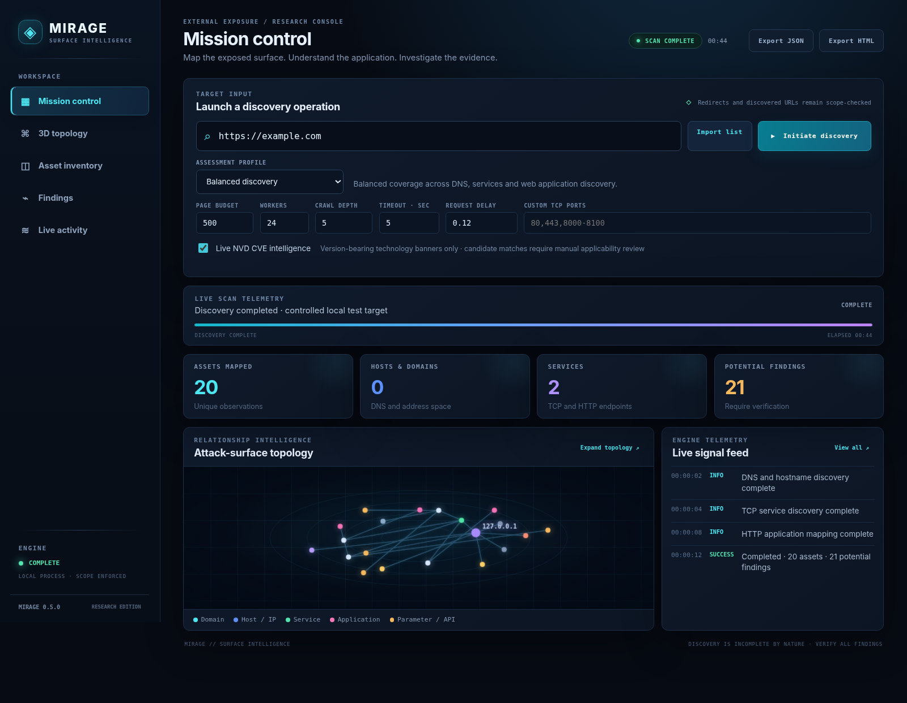
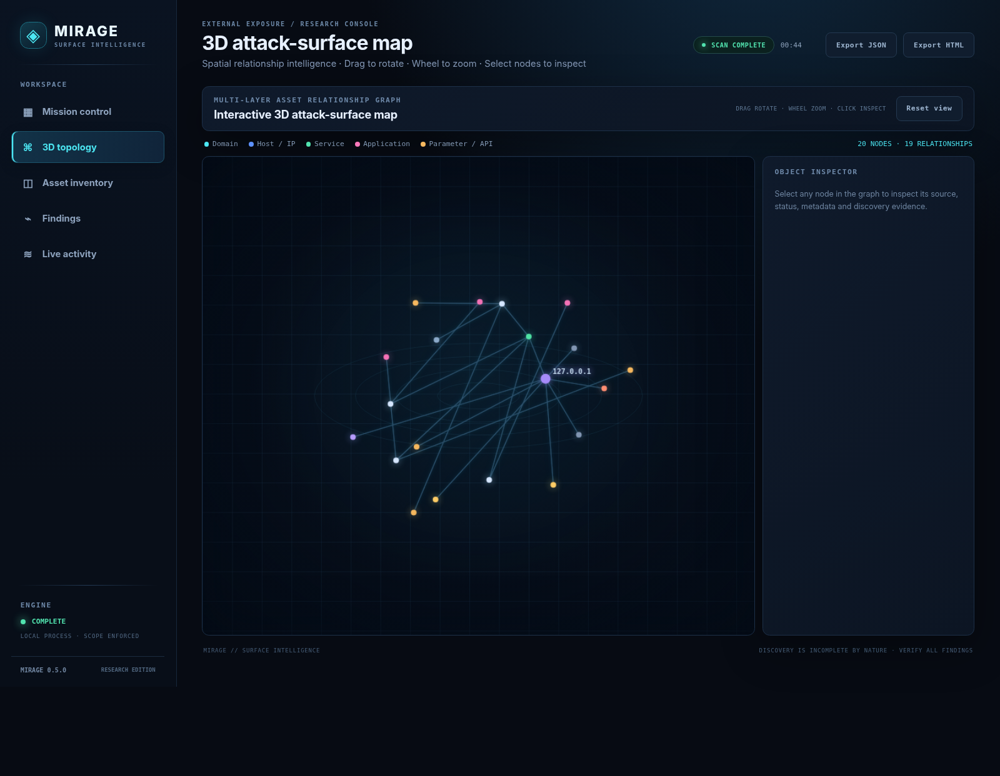
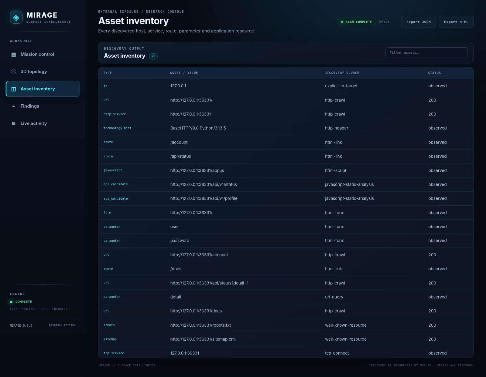
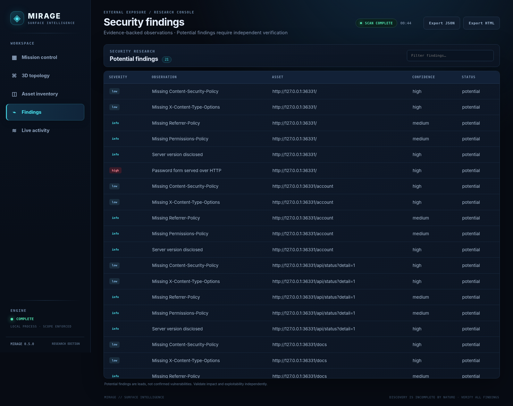

<div align="center">
  
  <h1>MIRAGE</h1>
  <p><strong>ATTACK-SURFACE INTELLIGENCE · WEB APPLICATION RESEARCH</strong></p>
  <p>Discover the surface. Map the relationships. Investigate the evidence.</p>
  <p>
    
    
    
    
    
  </p>
</div>

---
### Mission Control

<p align="center"></p>

Mission Control brings target input, scan configuration, live operation state, elapsed time, discovery metrics, the relationship-map preview and engine activity into one workspace. The metric cards open their corresponding inventory or findings views.

### Interactive 3D topology

<p align="center"></p>

The topology is rendered by the application itself. Drag to rotate, use the mouse wheel to zoom, and select a node to inspect its discovery source, status and observed metadata. The map is a relationship view of discovered records; it is not a geographic map.

### Asset inventory

<p align="center"></p>

Filter and inspect discovered domains, addresses, services, routes, parameters, application resources and other supported observation types.

### Potential findings

<p align="center"></p>

Findings include severity, confidence, affected asset, evidence and remediation guidance where available. A potential finding is a lead to verify—not proof of exploitability.

---

## What MIRAGE does

MIRAGE is a local desktop reconnaissance and web-application intelligence tool. It accepts domains, URLs, IP addresses, CIDR ranges and imported target lists, then organizes observations into an asset inventory, potential security findings, reports and an interactive relationship graph.

The intended workflow is:

```text
Target input
    │
    ▼
Scope validation
    │
    ▼
DNS / hostname discovery ──► TCP service discovery
    │                               │
    └──────────────┬────────────────┘
                   ▼
          HTTP application mapping
                   │
                   ▼
      Routes · Forms · Parameters · JS
                   │
                   ▼
       Non-destructive security checks
                   │
                   ▼
     Evidence · Inventory · Topology · Reports
```

### Implemented capabilities in 0.5.0

| Area | What the current release does |
|---|---|
| Target input | Domain, URL, IPv4/IPv6 address, CIDR and newline-separated target lists |
| Host discovery | Certificate Transparency lookup through `crt.sh`, DNS wordlist enumeration, A/AAAA resolution and supported DNS RRsets |
| DNS records | CNAME, MX, NS, TXT, SOA, CAA and SRV where available through dnspython |
| Network services | Bounded TCP connect checks on selected ports; common web ports and user-selected ports |
| HTTP/S | HTTP/HTTPS probing, including supported non-standard web ports |
| TLS | Certificate metadata, expiry, negotiated TLS version and cipher information |
| Web mapping | Bounded HTML crawling, internal links, routes, query parameters, forms, fields and JavaScript references |
| Static JavaScript review | Extracts API-like path candidates and possible hard-coded secret indicators using static inspection |
| Web conventions | `robots.txt`, sitemap ingestion and selected common exposure-path checks |
| Security posture | Selected HTTP security headers, CSP indicators, HSTS age, cookie attributes, server/version disclosure, plain-HTTP password-form indicators and directory-index observations |
| Vulnerability intelligence | Optional NVD keyword lookups for selected version-bearing technology banners; matches are explicitly low-confidence candidates |
| Results | SQLite history, structured evidence, JSON export and self-contained HTML report |
| Desktop UI | Mission Control, scan telemetry, asset inventory, findings, activity feed and interactive WebGL topology |

### What MIRAGE does not claim to do

The following are **not implemented in this release** and must not be inferred from a scan result:

- Browser-rendered JavaScript execution or full single-page-application route discovery.
- Authenticated crawling, login/session management or role-to-role authorization comparisons.
- Full ASN/RDAP enrichment, historical DNS, reliable origin/CDN attribution or robust virtual-host enumeration.
- Comprehensive UDP scanning, packet-level scanning or complete protocol fingerprinting.
- Full JavaScript AST parsing, source-map recovery or comprehensive secret validation.
- Full OpenAPI/Swagger schema parsing or GraphQL schema analysis.
- Comprehensive CPE matching, NVD configuration-tree applicability evaluation or offline vulnerability-feed synchronization.
- Active validation of SQL injection, XSS, SSRF, file upload, authentication bypass or business-logic vulnerabilities.
- Distributed scanning, team collaboration, a plugin marketplace or a polished native installer.

A technology banner is not proof that a product is vulnerable. NVD keyword matches can be false positives, and a version string may be misleading or describe a patched build. Verify affected-version ranges and configuration independently.

---

## Installation

### Requirements

- Linux desktop environment.
- Python 3.11 or newer.
- `dnspython` 2.6.x.
- Chromium/Chrome is recommended for a standalone application window. If unavailable, MIRAGE opens the system default browser.

The desktop service binds to loopback (`127.0.0.1`) and uses a per-launch random session token for API requests. Keep the launching process running while using the desktop UI.

### From a source checkout

```bash
git clone https://github.com/0xaprn/mirage.git
cd mirage
python3 --version
python3 -m pip install --user .
```

On distributions that mark the system Python as externally managed, use the distribution's supported package manager for Python dependencies rather than forcing pip to overwrite system-managed packages. On Gentoo, check the available `dev-python/dnspython` package and your system's Python target configuration before installing. MIRAGE does not require a Python virtual environment.

If you prefer not to install the package, run directly from the checkout after installing the dependency through your distribution:

```bash
python3 launch_gui.py
```

### Launch commands

Installed desktop launcher:

```bash
mirage-gui
```

Source checkout:

```bash
python3 launch_gui.py
```

CLI help and version:

```bash
mirage --help
mirage --version
```

---

## Desktop GUI: complete operator workflow

### 1. Start MIRAGE

Launch with `mirage-gui` or `python3 launch_gui.py`. A local desktop console opens in Chromium/Chrome app mode when available. Otherwise it opens in the default browser. Do not close the terminal process while the console is in use; `Ctrl+C` stops the local desktop service.

### 2. Enter targets

The target field accepts one of the following:

- `example.com` — domain and its in-scope subdomains.
- `https://example.com/portal` — starting URL for web mapping.
- `192.0.2.10` — explicit IPv4 address.
- `2001:db8::10` — explicit IPv6 address.
- `192.0.2.0/28` — explicit IPv4 CIDR range.

Use **Import list** to load a text file with one target per line. Blank lines and lines beginning with `#` or `;` are ignored. MIRAGE supports a maximum of 256 targets in one GUI batch. Imported targets are scanned sequentially and the results are aggregated in the interface.

Example `targets.txt`:

```text
# Example engagement scope
example.com
https://portal.example.net/
192.0.2.10
192.0.2.0/28
```

Use only targets explicitly included in your written authorization and engagement scope.

### 3. Select an assessment profile

| Profile | Intended use | Behavior |
|---|---|---|
| Balanced discovery | General first pass | Balanced DNS, service and web mapping budgets |
| Deep web mapping | More thorough application mapping | Larger page budget, deeper crawl and additional common web ports |
| Infrastructure focus | Host/service inventory | Broader selected TCP service coverage and shallow web crawling |
| Fast surface snapshot | Quick baseline | Smaller page budget and restrained service selection |
| Custom configuration | Operator-controlled scan | Set the individual limits described below |

Profiles are GUI presets. The CLI exposes the underlying individual controls rather than a named-profile switch.

### 4. Tune the scan

| Setting | Meaning | Practical guidance |
|---|---|---|
| Page budget | Maximum pages to crawl | Raise for larger sites; a larger budget does not guarantee complete coverage |
| Workers | Concurrent discovery workers | Increase cautiously; high concurrency can burden targets and local resources |
| Crawl depth | Maximum link traversal depth | Increase for deeper site structures |
| Timeout | Network operation timeout in seconds | Raise for slow or distant services |
| Request delay | Minimum per-request delay in seconds | Use a conservative delay appropriate to the engagement |
| Custom TCP ports | Comma-separated ports and ranges | Example: `80,443,8000-8100,8443` |
| Live NVD CVE intelligence | Optional version-banner keyword lookups | Disable to avoid external NVD lookups; candidate matches still require validation |

The application constrains GUI values to bounded ranges. A scan's coverage depends on scope, network reachability, rate limits, timeouts, content and the configured budgets.

### 5. Start and monitor discovery

Select **Initiate discovery**. Mission Control displays the operation state, current stage, elapsed time, metrics and recent engine events. Open **Live activity** for the chronological event stream.

The progress bar represents operation state, not a precise percentage of all possible assets. Discovery is open-ended: a completed operation means the configured work finished, not that every asset or vulnerability was found.

### 6. Explore the 3D topology

Open **3D topology** after discovery completes.

- **Drag** in the graph to rotate the view.
- **Mouse wheel** to zoom in or out.
- **Select a node** to open its object inspector.
- **Reset view** restores the default camera orientation.

Node colors distinguish observed asset categories. Lines represent relationships assembled from discovered records. The graph is a navigational view; use the asset inventory and finding evidence for the underlying details.

### 7. Review assets and findings

**Asset inventory** lists discovered observations and supports text filtering. Select a row to inspect its metadata.

**Findings** lists potential security observations with severity, confidence, affected asset and status. Select a finding to inspect its evidence and remediation guidance. Confirm the observation independently before treating it as a vulnerability or reporting it as exploitable.

### 8. Export results

Use **Export JSON** for structured data or **Export HTML** for a self-contained report. CLI users can also select output paths using `--json` and `--html`.

---

## Terminal CLI: full usage

The CLI is designed for repeatable terminal workflows, scripting and batch target files. It prints discovery-stage messages as the engine works.

### Basic domain scan

```bash
mirage example.com
```

### Start from a URL

```bash
mirage https://example.com/account
```

### Save JSON and HTML reports

```bash
mirage example.com \
  --json results.json \
  --html results.html
```

### Scan an IP address or CIDR range

```bash
mirage 192.0.2.10 --ports 22,80,443,8080,8443
mirage 192.0.2.0/28 --ports 22,80,443,8000-8100
```

Use only IP addresses and ranges explicitly in scope. Large CIDR ranges are not automatically expanded without limit; ranges over the implementation's expansion threshold are recorded as a coverage limitation.

### Scan multiple targets from a file

```bash
mirage --targets-file targets.txt \
  --json batch-results.json \
  --html batch-results.html
```

One target per line. Lines beginning with `#` are ignored. Each target is processed in sequence; for multi-target output, MIRAGE creates target-specific report filenames using the scan identifier.

### Use a custom subdomain wordlist

```bash
mirage example.com \
  --wordlist wordlists/subdomains-small.txt
```

The wordlist contains one candidate subdomain label per line. The bundled list is intentionally small; it is a starter list, not an exhaustive enumeration corpus.

### Tune concurrency, crawl depth, timeout and delay

```bash
mirage example.com \
  --timeout 6 \
  --concurrency 16 \
  --delay 0.20 \
  --max-pages 500 \
  --max-depth 5 \
  --ports 80,443,8000-8100,8443 \
  --db ~/.local/share/mirage/mirage.sqlite3 \
  --json mirage.json \
  --html mirage.html
```

### CLI options

| Option | Default | Description |
|---|---:|---|
| `target` | — | Domain, URL, IP address or CIDR |
| `--targets-file FILE` | — | Text file with one target per line |
| `--wordlist FILE` | — | Subdomain candidate labels, one per line |
| `--db PATH` | `~/.local/share/mirage/mirage.sqlite3` | SQLite history database |
| `--json PATH` | — | Write JSON report |
| `--html PATH` | — | Write HTML report |
| `--timeout SECONDS` | `5.0` | Network timeout |
| `--concurrency N` | `12` | Concurrent discovery workers |
| `--max-pages N` | `150` | Maximum pages for web crawling |
| `--max-depth N` | `3` | Maximum crawl depth |
| `--delay SECONDS` | `0.15` | Minimum per-request delay |
| `--ports LIST` | Engine defaults | Override TCP connect ports; accepts comma-separated ports and ranges |
| `--version` | — | Print MIRAGE version |
| `--help` | — | Print CLI help |

### Port syntax

```text
80,443,8080
80,443,8000-8100
22,25,53,80,110,143,443,445,3306,5432
```

Port values must be between 1 and 65535. A range can contain at most 4096 ports. Invalid values are rejected.

### SQLite history

By default, the engine stores scan history in:

```text
~/.local/share/mirage/mirage.sqlite3
```

Override the path with `--db`. The database stores scan records and structured observations; report exports remain separate files.

---

## Scope, safety and operating boundaries

MIRAGE enforces technical scope boundaries, but software controls do not grant permission. Only assess systems you own or are explicitly authorized to test. Follow the written engagement scope, rate limits and applicable rules.

- Domain scope includes the named domain and its subdomains. It does not automatically authorize unrelated third-party hosts discovered in page content.
- IP addresses and CIDR ranges are explicit target scope. CIDR expansion is bounded; oversized ranges are not silently treated as fully scanned.
- Extracted URLs and redirects are checked against scope before following them.
- TCP checks use ordinary connection attempts.
- HTTP checks use bounded, ordinary requests. Forms are inspected, not submitted.
- No credential guessing, exploit payload delivery, persistence, stealth, destructive action or defacement is implemented.
- Common exposure checks are read-only observations and may require manual confirmation.
- Certificate Transparency entries are discovery leads, not proof of ownership or authorization.
- NVD matches are candidate intelligence, not confirmed vulnerability determinations.

Read [SECURITY.md](SECURITY.md) and [docs/THREAT_MODEL.md](docs/THREAT_MODEL.md) before using MIRAGE in an engagement. See [docs/TEST-LABS.md](docs/TEST-LABS.md) for safe local test environments.

---

## Testing and development

Run the automated tests from the repository root:

```bash
python3 -m compileall -q mirage launch_gui.py
python3 -m unittest discover -s tests -v
```

The test suite uses unit tests and local fixtures. It is not an independent security audit, a broad compatibility matrix or a performance benchmark against production infrastructure.

Useful project documents:

- [Build status](BUILD-STATUS.md) — implemented checks and known limitations.
- [Architecture](docs/ARCHITECTURE.md) — component layout and data flow.
- [Roadmap](docs/ROADMAP.md) — planned work versus current implementation.
- [Threat model](docs/THREAT_MODEL.md) — trust boundaries and operating assumptions.
- [Safe test labs](docs/TEST-LABS.md) — controlled environments for validation.
- [Contributing](CONTRIBUTING.md) — contribution workflow.

### Repository layout

```text
mirage/
├── mirage/                  # Discovery engine, scope, CLI, GUI, reports and storage
│   └── webui/               # Shipped desktop HTML, CSS and JavaScript
├── tests/                   # Unit and local integration tests
├── docs/                    # Architecture, roadmap, threat model and test labs
├── assets/                  # Brand assets and real application screenshots
├── wordlists/               # Starter subdomain labels
├── examples/                # Example target lists
├── launch_gui.py            # Desktop launcher
├── pyproject.toml
├── BUILD-STATUS.md
├── SECURITY.md
└── README.md
```

---

## Roadmap

MIRAGE is under active development. Areas for future work include browser-rendered SPA mapping, authenticated crawling, richer ASN/RDAP and DNS context, deeper API schema discovery, more rigorous CVE applicability analysis, historical comparison and expanded protocol coverage. These are roadmap items, not capabilities implied by the current release.

## License

Apache-2.0. See [LICENSE](LICENSE).

<div align="center">
  <sub>MIRAGE // SURFACE INTELLIGENCE · DISCOVERY IS INCOMPLETE BY NATURE · VERIFY ALL FINDINGS</sub>
</div>
